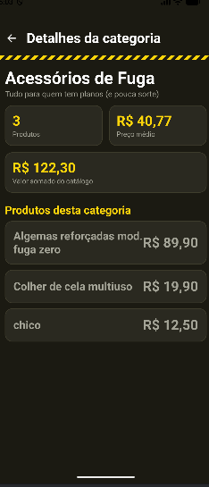
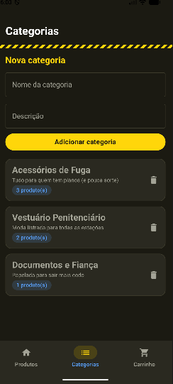
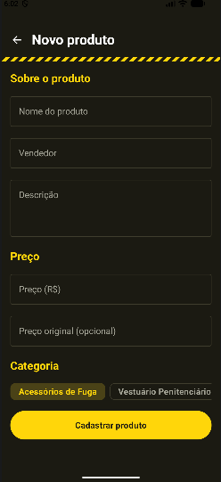
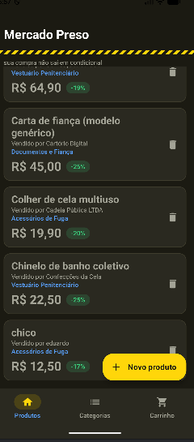

# Mercado Preso — Trabalho 2

App Android em Kotlin + Jetpack Compose: um marketplace paródia com tema de prisão ("sua compra não sai em condicional").

**Integrantes:** Eduardo Alan, Francisco Caninde

## Como rodar

1. Abra a pasta do projeto no Android Studio.
2. Aguarde o Gradle sincronizar (usa `navigation-compose` e Material3).
3. Rode em um emulador ou celular (Run ▶ `app`).

Os dados ficam só na memória (`mutableStateListOf`): ao fechar o app, o que foi adicionado se perde, como permitido na seção 5 do enunciado.

## 1. Como estava o Trabalho 1 e o que mudou

No Trabalho 1 o projeto tinha apenas **3 telas** (Detalhe do produto, Carrinho e Pedido confirmado), e elas eram só visuais: nada funcionava, os botões não faziam nada e não havia navegação entre as telas.

**Telas do Trabalho 1:**

| Detalhe do produto | Carrinho | Pedido confirmado |
|:---:|:---:|:---:|
|  |  |  |

Agora o app tem **8 telas** navegáveis de verdade, com `NavHost`, `BottomNavigation`, duas listas com adicionar/remover e duas telas de detalhes que recebem o item certo.

> 📸 *Print do app atual (inserir aqui)*

## 2. As telas e por que foram escolhidas

| # | Tela | O que faz | Por que existe |
|---|------|-----------|----------------|
| 1 | **Produtos** (aba) | Lista de produtos (`LazyColumn` + `Card`), lixeira para remover e botão "Novo produto" | Lista principal de um marketplace |
| 2 | **Detalhe do produto** | Mostra o produto clicado, com desconto, parcela, economia, categoria, edição de preço, "Comprar agora" e "Adicionar ao carrinho" | Detalhes da lista 1 |
| 3 | **Novo produto** | Formulário (texto, número, várias linhas, escolha de categoria) com validação | Forma de adicionar na lista 1 |
| 4 | **Categorias** (aba) | Lista de categorias com formulário para adicionar e lixeira para remover | Segunda lista, segundo tipo de item |
| 5 | **Detalhe da categoria** | Mostra os produtos da categoria, quantidade, valor somado e preço médio | Detalhes da lista 2 |
| 6 | **Carrinho** (aba) | Checkbox, quantidade +/−, cupom, subtotal, frete, total e "Finalizar prisão da compra" | Já existia visualmente no Trabalho 1; agora funciona |
| 7 | **Pedido confirmado** | Resumo do pedido, com número e total reais, e botões de acompanhar/voltar | Fecha o fluxo de compra |
| 8 | **Acompanhar pedido** | Linha do tempo com botão que simula as etapas de entrega | Dá função real ao botão "Acompanhar prisão do pedido" |

> 📸 |   |  |  |
>     |  |  |  |
>     |  |  |
  

## 3. Organização do código

| Arquivo | Conteúdo |
|---------|----------|
| `Modelos.kt` | As data classes `Produto`, `Categoria` e `ItemCarrinho`, o objeto `Rotas` e a classe `LojaState` |
| `MainActivity.kt` | `NavHost`, `NavController` e o `BottomNavigation` |
| `Componentes.kt` | Tema, `BarraTopo` (com botão de voltar) e funções auxiliares |
| `TelasProdutos.kt` | Telas 1, 2 e 3 |
| `TelasCategorias.kt` | Telas 4 e 5 |
| `TelasCarrinho.kt` | Telas 6, 7 e 8 |

Decisões:

- **Rotas num objeto `Rotas`:** evita escrever texto solto pelo código e erro de digitação. As rotas com argumento (`produto/{id}`, `categoria/{id}`) têm funções que montam o caminho.
- **Estado em uma classe `LojaState`:** as listas (`produtos`, `categorias`, `carrinho`) são `mutableStateListOf` e ficam todas na `LojaState`, criada uma vez no `NavHost` e passada às telas. Assim, adicionar, remover ou comprar em uma tela atualiza as outras (por exemplo, remover um produto também tira ele do carrinho).
- **Passagem de dados por `id`:** as telas de detalhes recebem só o `id` pela rota e buscam o item na lista. Por isso mostram sempre o item certo, e a tela se atualiza se o item for editado.
- **`BottomNavigation` só nas 3 telas principais:** Produtos, Categorias e Carrinho. As telas de detalhes e formulários usam botão de voltar (`popBackStack()`).

## 4. Complexidade extra na tela de Detalhes

Fizemos nas duas telas de detalhes, indo além de reexibir os campos:

- **Detalhe do produto:**
  - mostra valores **calculados** a partir dos dados (desconto em %, parcela em 6x, economia);
  - permite **editar o preço** ali mesmo (o carrinho também é atualizado);
  - abre uma **navegação secundária**: clicar na categoria leva ao detalhe dela.
- **Detalhe da categoria:** **combina dados das duas listas**: lista os produtos daquela categoria e calcula quantidade, valor somado e preço médio.

Escolhemos isso porque um marketplace precisa mostrar preço e economia com clareza, e relacionar produto e categoria mostra de verdade o uso de duas data classes.

> 📸 |   |    |

## 5. Dificuldades

**1. Produto adicionado não aparecia na lista (cada tela com seu próprio estado)**
No começo, cada tela criava a sua própria lista com `mutableStateListOf`. Na tela "Novo produto" o cadastro funcionava e não dava nenhum erro, mas ao voltar para a lista o produto novo não estava lá. A mesma coisa acontecia com o carrinho: o que era adicionado no detalhe do produto não aparecia na aba Carrinho. Demoramos para entender porque parecia que o código de adicionar estava certo. O problema era que cada tela tinha uma **cópia separada** da lista, e ao navegar o Compose recriava a tela e a lista voltava ao valor inicial. Resolvemos criando a classe `LojaState`, que guarda `produtos`, `categorias` e `carrinho` em um só lugar. Ela é criada uma única vez no `NavHost` e passada para todas as telas. Depois disso, adicionar ou remover em uma tela atualiza as outras (inclusive remover um produto também tira ele do carrinho). Aprendemos que o estado que várias telas usam não pode ficar dentro de cada tela, e sim em um lugar comum acima delas.

## Checklist

- [x] 8 telas, todas navegáveis
- [x] `BottomNavigation` funcionando
- [x] 2 data classes diferentes e 2 telas de lista (`LazyColumn` + `Card`)
- [x] Adicionar e remover em cada lista
- [x] 2 telas de detalhes, cada uma com o item certo
- [x] Detalhes com algo a mais do que o exemplo de aula
- [x] Objeto `Rotas`
- [x] Botão de voltar funcional (`popBackStack()`)
